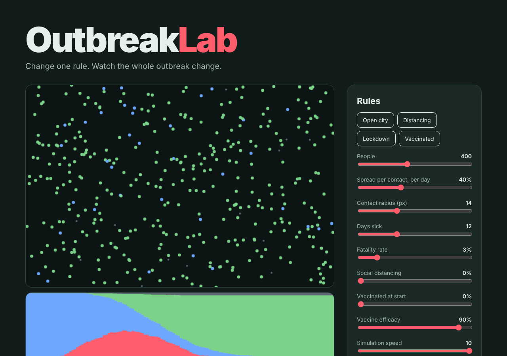

# OutbreakLab

Change one rule. Watch the whole outbreak change.



**Live demo: https://simakogan.github.io/outbreak-lab/**

OutbreakLab is an agent-based outbreak simulator that runs in the browser. Hundreds of people wander around a map, a few start out sick, and the infection spreads whenever a sick person comes close to a healthy one. Move a slider and the curve reshapes in real time.

No dependencies, no build step, no network access.

## Run it

```
python3 -m http.server 8000
```

Open http://localhost:8000. You can also just open `index.html` in a browser.

## What you can play with

| Rule | Effect |
| --- | --- |
| People | Size of the population (restarts the world) |
| Spread per contact | Daily chance that a close contact passes it on |
| Contact radius | How close counts as contact |
| Days sick | How long a person stays infectious |
| Fatality rate | Share of sick people who die instead of recovering |
| Social distancing | Slows everyone down, so fewer meetings happen |
| Vaccinated at start | Share of people who begin protected (restarts the world) |
| Vaccine efficacy | How much a vaccine reduces the chance of infection |

Presets (Open city, Distancing, Lockdown, Vaccinated) set up common scenarios in one click. Click anyone on the map to infect them, or use **Add 5 sick** to start a new wave.

## How it works

Each person is Healthy, Sick, Recovered, Vaccinated or Deceased. One step is 0.1 day. Every step people move in a slightly random direction, each sick person may infect healthy people within the contact radius, and sick people recover or die after the set number of days. The chart stacks all five groups over time.

The simulation core is in `sim.js` and is seeded, so the same seed always gives the same outbreak.

## Tests

```
node test.js
```

The tests check determinism, that the population is conserved, that distancing and vaccines work, and that outbreaks end.

## See also

[EpiSim](https://github.com/SimaKogan/epi-sim) is the full-stack sibling of this project: an agent-based SEIR model with virus mutations, travel between settlements, lockdown, masks and testing, running on a Java Spring Boot backend with a React canvas frontend.

## Note

This is a toy model for exploring ideas. It is not an epidemiological forecast.

## License

MIT, see [LICENSE](LICENSE). Made by [SimaKogan](https://github.com/SimaKogan).
